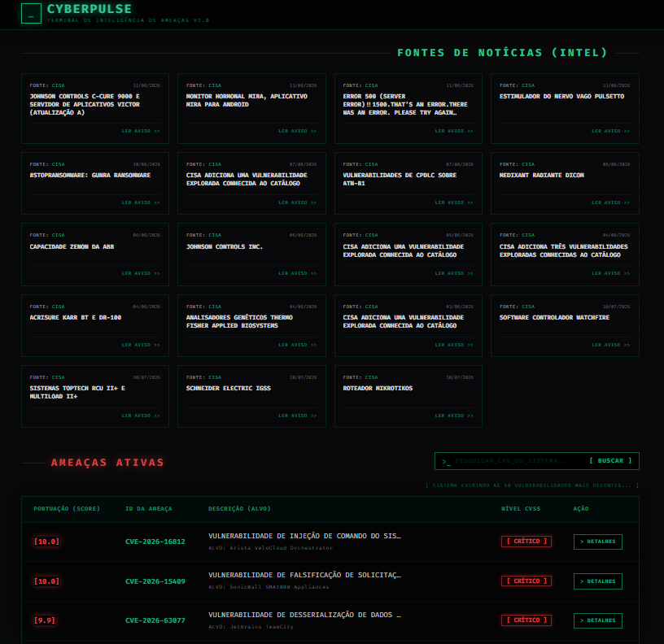
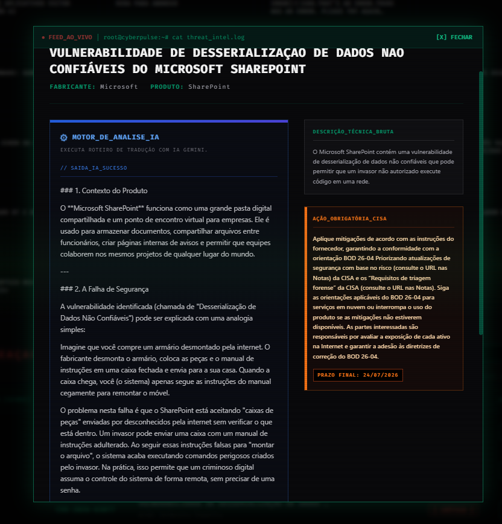
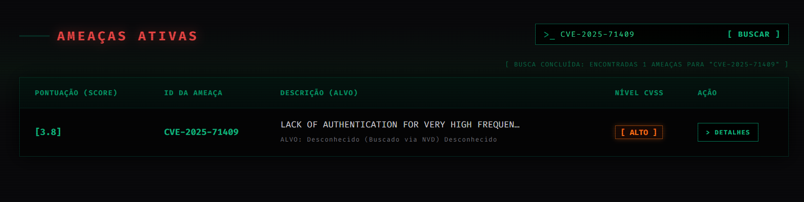

# CyberPulse - Terminal de Inteligência de Ameaças 🛡️


> Um agregador de inteligência de ameaças em tempo real construído com estética Hacker/Cyberpunk. Monitoramento global, pontuação de risco customizada e análise de vulnerabilidades alimentada por Inteligência Artificial (Gemini).

---

## 🌐 Acesse a Plataforma ao Vivo (Live Demo)
O projeto já está hospedado e funcionando 24/7 na nuvem. Você pode testar todas as funcionalidades diretamente pelo navegador:

👉 **[ACESSAR CYBERPULSE AGORA](https://cyberpulse-ochre.vercel.app)** *(Link de Produção)*

---

## 🚀 Como Utilizar e Testar a Plataforma

Para ter a experiência completa de um Analista de Cibersegurança, siga os passos abaixo no site ao vivo:

### 1. Configure a Inteligência Artificial (100% gratuito)
A IA traduz jargões técnicos para uma linguagem clara e diz como corrigir a falha. Clique em qualquer ameaça e,
no quadro da IA, cole uma ou as duas chaves. **As duas são gratuitas:**

| Chave | Papel |
|---|---|
| **Google Gemini** ([gerar chave grátis](https://aistudio.google.com/app/apikey)) | IA principal, com busca no Google |
| **OpenRouter** ([gerar chave grátis](https://openrouter.ai/settings/keys)) | **Reserva:** assume na hora quando o Gemini está sobrecarregado |

- O OpenRouter usa **somente modelos gratuitos** (`:free`). O código confere no catálogo público que o modelo
  tem preço zero antes de cada chamada e não usa a busca na web do OpenRouter, que é cobrada. Limite do plano
  gratuito do OpenRouter: 50 análises por dia por conta.
- Se as duas IAs falharem e já existir uma análise salva, ela é mostrada com um aviso, em vez de erro.
- **Copiar prompt:** cada vulnerabilidade tem um botão que copia um prompt pronto, com todos os dados da CVE,
  para colar em qualquer chat de IA (inclusive a IA homologada da sua empresa). Funciona mesmo se as IAs do site
  estiverem fora do ar.
- As chaves ficam **só no seu navegador** e são repassadas ao backend apenas para chamar a IA:
  **não são gravadas no banco nem em logs**.
- Análises já geradas ficam salvas e aparecem para qualquer pessoa, **mesmo sem chave**.

### 2. Drible o "Delay" do Governo Americano (Busca Real-Time)
A base KEV da CISA pode levar horas para atualizar. Se uma CVE ainda não aparece na tabela, pesquise o código
(ex: `CVE-2024-3094`) e aperte `[ BUSCAR ]`: o sistema busca na hora no NVD e a adiciona ao banco.

### 3. Entenda o "Risk Score (CyberPulse)"
A nota (0 a 10) combina sinais que realmente diferenciam as ameaças, e é recalculada a cada 30 minutos:

| Componente | Peso | Fonte |
|---|---|---|
| Severidade (CVSS v4.0 / v3.x / v2) | 35% | NVD |
| Probabilidade de exploração em 30 dias (EPSS) | 25% | FIRST.org |
| Exploração ativa confirmada | 15% | CISA KEV |
| Uso em campanhas de ransomware | 10% | CISA KEV |
| Urgência: recência (meia-vida de 60 dias) ou prazo CISA vencendo | 15% | CISA / NVD |

O detalhamento de cada CVE aparece no modal e em `GET /api/v1/vulnerabilities/{cve}/score`.

---

## 📸 Screenshots





---

## 🛠️ Arquitetura Técnica (Para Desenvolvedores)

- **Backend:** FastAPI (Python), SQLAlchemy, PostgreSQL, APScheduler + cron do GitHub Actions.
- **Frontend:** React, TypeScript, TailwindCSS.
- **Inteligência Artificial:** Google Gemini (SDK `google-genai`) com reserva gratuita no OpenRouter, modelos reserva automáticos, cache e prompt copiável.
- **Deploy Cloud:** Vercel (Frontend) e Render (Backend/Robôs).

### Rodando Localmente com Docker
Se você quiser clonar e rodar o projeto na sua máquina para estudar o código:
```bash
# Clone o repositório
git clone https://github.com/Alanbtx/cyberpulse.git
cd cyberpulse

# Suba todos os containers (Banco de Dados, Backend e Frontend)
docker compose up -d --build
```
Após compilar, acesse `http://localhost:5173`. O backend já começará a varrer a internet populando seu banco de dados local através do agendador automático (APScheduler).

### Testes
```bash
cd backend && pip install -r requirements-dev.txt && pytest -q
cd frontend && npm ci && npm run typecheck && npm run build
```

## ⚙️ Configuração de Deploy

### Render (backend)
Variáveis de ambiente (modelo completo em [`.env.example`](./.env.example)):

| Variável | Obrigatória | Descrição |
|---|---|---|
| `DATABASE_URL` | sim | Postgres |
| `CORS_ORIGINS` | recomendada | Padrão: `https://cyberpulse-ochre.vercel.app,http://localhost:5173` |
| `ADMIN_TOKEN` | para o cron | Token longo e aleatório. Sem ele, as rotas `/api/v1/admin/*` ficam desligadas |
| `NVD_API_KEY` | opcional | [Chave gratuita](https://nvd.nist.gov/developers/request-an-api-key): 10x mais rápido para preencher CVSS |
| `GEMINI_MODEL` / `GEMINI_FALLBACK_MODEL` | opcional | Troca de modelo sem precisar de deploy |
| `OPENROUTER_MODELS` | opcional | Modelos gratuitos da reserva, em ordem (IDs pagos são ignorados). Padrão: `nvidia/nemotron-3-ultra-550b-a55b:free,google/gemma-4-31b-it:free` |

Comando de start (se não usar o Dockerfile):
```bash
uvicorn app.main:app --host 0.0.0.0 --port $PORT --proxy-headers --forwarded-allow-ips='*'
```

### Vercel (frontend)
- `VITE_API_URL` = URL do backend no Render.
- O arquivo [`frontend/vercel.json`](./frontend/vercel.json) aplica CSP e cabeçalhos de segurança (o *Root Directory* do projeto na Vercel deve ser `frontend`).
  Se a URL do backend mudar, atualize também o `connect-src` da CSP.

### GitHub Actions
- **CI**: testes, typecheck, build e auditoria de dependências em todo PR.
- **Atualizar dados**: a cada 6h acorda a API (o plano gratuito do Render hiberna) e dispara a coleta.
  Configure os secrets `API_URL` e `ADMIN_TOKEN` em *Settings → Secrets and variables → Actions*.
- **Dependabot**: PRs semanais de atualização de dependências.

## 🔒 Segurança
- Sem rotas públicas que disparem coletas: elas exigem `X-Admin-Token`.
- Limite de requisições por IP na IA e na busca em tempo real; `limit` máximo de 200 por página.
- CORS restrito, `/docs` desligado em produção, erros sem detalhes internos.
- Uma conexão com o Gemini por requisição: a chave de um usuário nunca é usada no pedido de outro.
- Container sem root e sem `--reload`; Postgres local exposto só em `127.0.0.1`.
